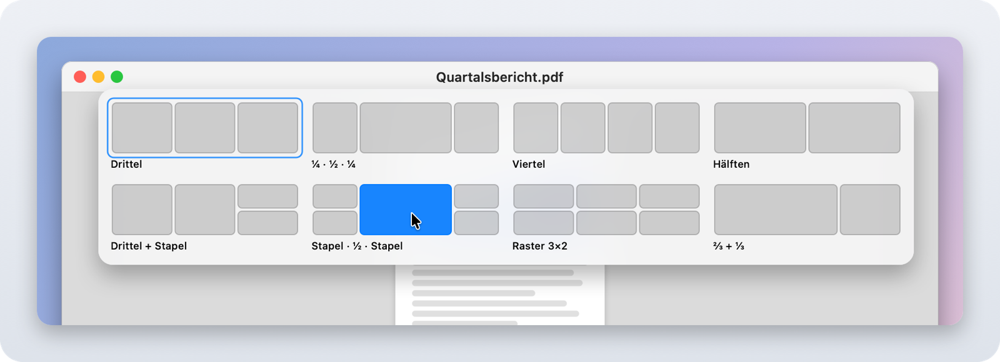
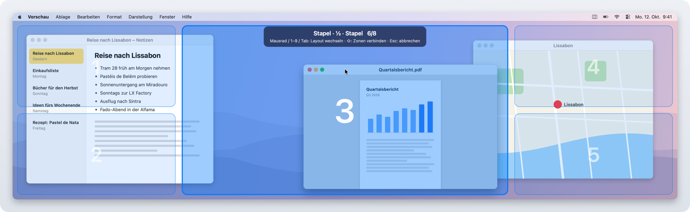
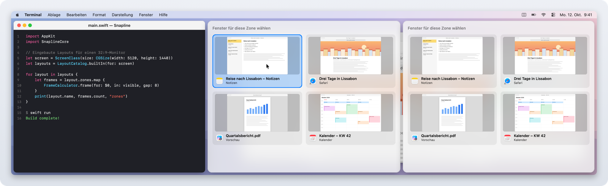
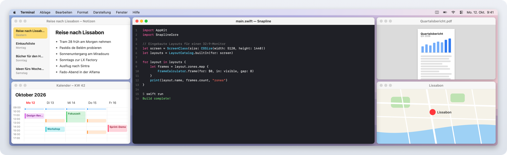

# Snapline

[](https://github.com/search?q=topic%3Ai-love-macos-but-i-miss-windows-features+user%3Aleonatwork&type=repositories)

*🇬🇧 [English version](README.md)*

Windows-11-Fensterverwaltung für macOS: Snap Layouts, Snap Bar, Aero Snap, Snap Assist und Win+Pfeiltasten. Gebaut für Ultrawide- und Super-Ultrawide-Monitore wie den Samsung Odyssey G9 (32:9).

Menüleisten-App, ohne Abhängigkeiten, Swift + AppKit.

Sprachen: Snapline folgt der macOS-Sprache und spricht Englisch, Deutsch, Französisch, Spanisch, Italienisch, Portugiesisch (Brasilien), Niederländisch, Japanisch, Chinesisch (vereinfacht) und Koreanisch.

## Teil des Pakets

Snapline gehört zum Paket **„I love macOS, but I miss some Windows features“**: vier kleine Tools, die Windows-Funktionen auf den Mac bringen.

| Tool | Was es macht | Download |
|---|---|---|
| [Tappi](https://github.com/leonatwork/Tappi) | Alt+Tab zwischen Fenstern statt Apps | [Neueste Version](https://github.com/leonatwork/Tappi/releases/latest) |
| [Klemmi](https://github.com/leonatwork/Klemmi) | Zwischenablage-Verlauf wie Win+V, mit Quell-App | [Neueste Version](https://github.com/leonatwork/Klemmi/releases/latest) |
| **[Snapline](https://github.com/leonatwork/snapline)** (dieses Tool) | Snap Layouts, Aero Snap und Snap Assist aus Windows 11 | [Neueste Version](https://github.com/leonatwork/snapline/releases/latest) |
| [Snapboard](https://github.com/leonatwork/snapboard) | Screenshots wie mit dem Snipping Tool, direkt in die Zwischenablage | [Neueste Version](https://github.com/leonatwork/snapboard/releases/latest) |

Vermisst du mehr als eine dieser Funktionen? Dann lad dir am besten [alle vier](https://github.com/search?q=topic%3Ai-love-macos-but-i-miss-windows-features+user%3Aleonatwork&type=repositories) herunter. In Snapline findest du sie auch im Menü unter **Weitere Apps, die dir gefallen könnten**.

## Screenshots

<div align="center">
  
  <br />
  <em>Snap Layouts: Hover über den grünen Knopf, dann eine Zone anklicken</em>
  <br /><br />
  
  <br />
  <em>⌘ + Ziehen: Das Fenster landet in einer Zone des aktiven Layouts</em>
  <br /><br />
  
  <br />
  <em>Snap Assist: Die freien Zonen bieten die übrigen Fenster an</em>
  <br /><br />
  
  <br />
  <em>Ergebnis: „Stapel · ½ · Stapel“ auf einem 32:9-Monitor</em>
</div>

Die Bilder sind gerendert, keine Bildschirmfotos: Die Fenster sind erfundene Demo-Inhalte, Flyout, Zonen-Overlay und Snap-Assist-Karten kommen aus Snapline selbst (siehe [Entwicklung](#entwicklung)).

## Funktionen

| Windows 11 | Snapline |
|---|---|
| Hover über Maximieren → Snap Layouts | Hover über den **grünen Knopf** → Layout-Flyout, Zone anklicken |
| Win + Z | **⌃⌥Z** (auf deutscher Tastatur auch ⌃⌥Y) |
| Fenster oben in die Mitte ziehen → Snap Bar | genauso: Leiste mit Layouts erscheint, Fenster auf eine Zone ziehen |
| Fenster an Rand/Ecke ziehen | linker/rechter Rand → äußere Spalte, Ecke → halbe Spalte, oberer Rand → maximieren, **unterer Rand → Spalte unter dem Cursor** |
| Snap Assist | Nach dem Snappen per Layout werden die übrigen Fenster in den freien Zonen angeboten |
| Win + ← / → | **⌃⌥← / →** wandert durch die Spalten und weiter auf den nächsten Monitor |
| Win + ↑ / ↓ | **⌃⌥↑** maximieren bzw. obere Hälfte · **⌃⌥↓** wiederherstellen, untere Hälfte, minimieren |
| Gesnapptes Fenster wegziehen | bekommt seine ursprüngliche Größe zurück |
| FancyZones: ⇧ + Ziehen | **⌘ + Ziehen** (Taste im Menü umstellbar: ⌘, ⌥ oder ⇧) legt das Fenster in die Zonen des aktiven Layouts. Dabei wechseln **Mausrad / 1–9 / Tab** das Layout, **⇧** verbindet mehrere Zonen, **Esc** bricht ab |
| FancyZones: Layout wechseln | **⌃⌥1…9** wählt das aktive Layout des Monitors (kurz eingeblendet) |
| FancyZones-Editor | **Layouts bearbeiten…**: Zonen teilen, Trennlinien ziehen, Zonen entfernen |
| – | **Arbeitsbereiche**: aktuelle Anordnung speichern, mit **⌃⌥⇧1…9** wiederherstellen, fehlende Apps werden gestartet |

Das macOS-eigene Kachel-Menü am grünen Knopf wird unterdrückt. Snapline fängt die Hover-Events dort per Event Tap ab (wie Tappi), sodass nur noch das Snapline-Flyout erscheint. Snap Assist zeigt Live-Vorschauen der Fenster (ScreenCaptureKit, wie in Tappi).

### Ausgeschlossene Apps

Aktiviere die gewünschte App und wähle im Snapline-Menü **Für &lt;App&gt; deaktivieren**, damit Snapline ihre Fenster in Ruhe lässt. Der Ausschluss gilt sofort für Rand- und Zonen-Ziehen, Snap Bar, Hover- und Tastatur-Snapping sowie Snap Assist; das macOS-eigene Menü am grünen Knopf wird nicht mehr unterdrückt. Mit **Für &lt;App&gt; wieder aktivieren** oder einem Klick auf die App unter **Ausgeschlossene Apps** entfernst du die Ausnahme. Die Liste startet leer und bleibt nach Neustarts erhalten. Arbeitsbereiche erfassen und platzieren weiterhin auch ausgeschlossene Apps.

### Seitenverhältnisse

Layouts und Spalten passen sich pro Monitor an:

- **32:9** (z. B. G9, 5120×1440): Drittel, ¼+½+¼, Viertel, Hälften, Stapel-Layouts, 3×2-Raster. Rand und Tastatur arbeiten mit Dritteln (im Menü auf Hälften oder Viertel umstellbar).
- **21:9**: Hälften, Drittel, ¼+½+¼, ⅔+⅓ …
- **16:9 / 16:10**: Hälften, ⅔+⅓, Drittel, Viertel …
- **Hochformat**: Zeilen statt Spalten.

## Installation

Benötigt macOS 14 oder neuer.

### Herunterladen

1. `Snapline-<Version>.zip` aus dem [neuesten Release](https://github.com/leonatwork/snapline/releases/latest) laden und entpacken.
2. `Snapline.app` in den Ordner **Programme** ziehen.
3. Beim ersten Start: Rechtsklick ▸ **Öffnen**. Ab macOS 15 stattdessen unter **Systemeinstellungen → Datenschutz & Sicherheit** auf **Dennoch öffnen** klicken.

Schritt 3 ist nötig, weil Snapline nicht von Apple notarisiert ist.

Die Release-Builds sind mit dem festen Zertifikat „leonatwork Code Signing“ signiert. Erteilte Berechtigungen (Bedienungshilfen, Bildschirmaufnahme) bleiben deshalb über Updates hinweg erhalten.

### Selbst bauen

Dafür reichen die Xcode Command Line Tools (`xcode-select --install`).

```bash
scripts/install.sh
```

Das baut die App, kopiert sie nach `/Applications` und startet sie. Beim ersten Start fragt macOS nach dem Zugriff auf **Bedienungshilfen**. Den brauchen wir, um Fenster anderer Apps zu verschieben.

### macOS-eigenes Kacheln abschalten

Seit macOS 15 kachelt macOS selbst, wenn man Fenster an den Rand zieht. Das kollidiert mit Snapline. Snapline zeigt im Menü eine Warnung, solange es aktiv ist.

**Systemeinstellungen → Schreibtisch & Dock → Fenster** und dort ausschalten:
- „Fenster an Bildschirmränder ziehen, um sie zu kacheln“
- „Fenster in die Menüleiste ziehen, um den Bildschirm zu füllen“

Außerdem „Halte ⌥ beim Ziehen gedrückt, um zu kacheln“, sonst kollidiert es mit ⌥ + Ziehen.

Alternativ im Snapline-Menü unter der Kacheln-Warnung **macOS-Kacheln jetzt ausschalten …** wählen. Die Bestätigung nennt die drei Schlüssel in `com.apple.WindowManager`, die auf `false` gesetzt werden: `EnableTilingByEdgeDrag`, `EnableTopTilingByEdgeDrag` und `EnableTilingOptionAccelerator`. Abbrechen ändert nichts. Nach der Bestätigung das Ergebnis in Schreibtisch & Dock prüfen und die Optionen dort ausschalten, falls macOS die Änderung noch nicht übernommen hat. Es werden keine Systemprozesse neu gestartet.

**Stage Manager:** Snapline warnt zusätzlich bei aktivem Stage Manager, auch wenn Drag-Snap ausgeschaltet ist. Ein Klick öffnet **Systemeinstellungen → Schreibtisch & Dock**. Gruppen und App-Streifen von Stage Manager können Fensterplatzierung und Snapping beeinflussen; Snapline berücksichtigt sie noch nicht. Der Kacheln-Button ändert Stage Manager (`GloballyEnabled`) niemals; seine Warnung bleibt, bis du Stage Manager selbst ausschaltest. Beide Warnungen werden bei jedem Öffnen des Menüs aktualisiert.

### Berechtigungen

- **Bedienungshilfen**: Fenster verschieben, Event Tap
- **Bildschirmaufnahme** (optional): Live-Vorschau in Snap Assist

Release-Builds sind mit „leonatwork Code Signing“ signiert, die Berechtigungen überstehen also Updates. Selbst gebaute Kopien werden mit einer lokalen Identität signiert. Damit die Berechtigungen auch einen Neubau überleben, einmal ausführen:

```bash
scripts/setup-signing.sh
```

Das legt ein lokales, selbstsigniertes Zertifikat „Snapline Local Signing“ an (wie bei Tappi). `scripts/build-app.sh` nutzt automatisch „leonatwork Code Signing“, falls vorhanden, sonst dieses lokale Zertifikat, ansonsten wird ad-hoc signiert, und macOS vergisst die Berechtigungen bei jedem Build.

Release-Build und selbst gebaute Kopie haben unterschiedliche Signaturen. Wer zwischen beiden wechselt, muss die Berechtigungen neu erteilen (in den Systemeinstellungen den alten Eintrag entfernen und Snapline erneut hinzufügen).

## Entwicklung

```bash
swift test               # Logik-Tests (Layouts, Geometrie, Rand- und Tastaturlogik)
swift run Snapline       # direkt starten (Berechtigung gilt dann fürs Terminal)
scripts/build-app.sh     # dist/Snapline.app bauen
scripts/check-localizations.sh  # Übersetzungen prüfen (alle Schlüssel in allen Sprachen, plutil -lint)
```

Aufbau:

- `Sources/SnaplineCore`: reine Logik ohne AppKit, vollständig getestet
- `Sources/Snapline/AX`: Accessibility-Zugriff auf Fenster
- `Sources/Snapline/Controllers`: Drag, Hover, Tastatur, Hotkeys
- `Sources/Snapline/UI`: Vorschau, Layout-Flyout, Zonen-Overlay, Snap Assist, Layout-Editor
- `Resources/<Sprache>.lproj/Localizable.strings`: Texte der Oberfläche (Englisch ist die Entwicklungssprache), Zugriff über `L10n.tr("schlüssel")`

Eigene Layouts und Arbeitsbereiche liegen als JSON in `~/Library/Application Support/Snapline/`.

Das Icon wird mit `swift scripts/make-icon.swift` erzeugt.

Die README-Screenshots in `docs/screenshots/` erzeugt `scripts/screenshots/render.sh` neu (Englisch `<name>.png`, Deutsch `<name>.de.png`). Das Skript nimmt nichts vom Bildschirm auf und liest keine eigenen Daten: Es baut SnaplineCore und die UI-Quellen der App zusammen mit einem kleinen Harness, rendert Flyout, Zonen-Overlay und Snap-Assist-Karten offscreen in doppelter Auflösung über erfundene Demo-Fenster und läuft dazu in einem temporären `.app`-Bundle mit den `.lproj`-Ordnern, damit die echten Übersetzungen greifen. Der Harness landet nicht in `Snapline.app`.

Details und Roadmap stehen in [PLAN.md](PLAN.md).

## Lizenz

[MIT](LICENSE) — freie Nutzung, Änderung und Weitergabe, ohne Gewährleistung.
