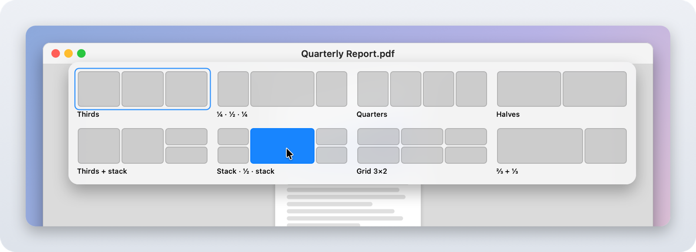
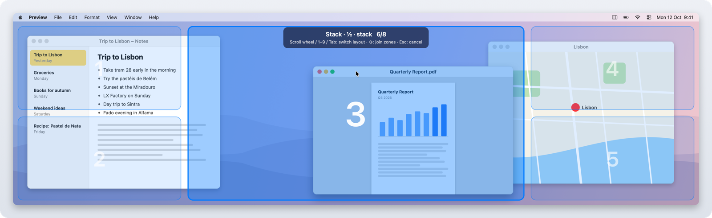
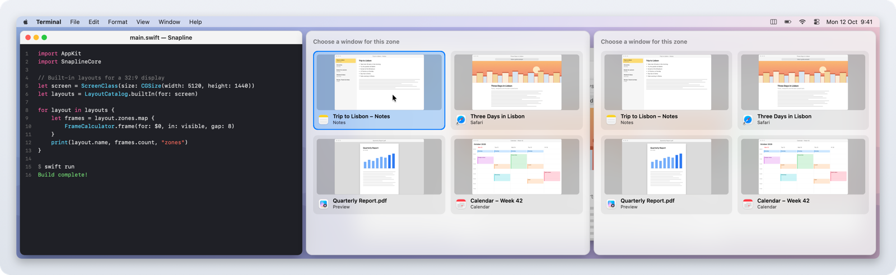
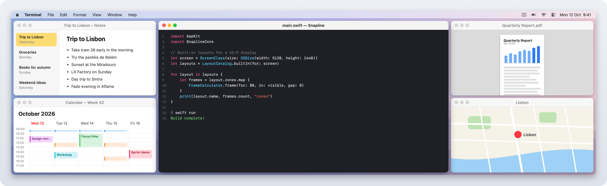

# Snapline

[](https://github.com/leonatwork/snapline/releases/latest)
[](https://github.com/search?q=topic%3Ai-love-macos-but-i-miss-windows-features+user%3Aleonatwork&type=repositories)

*🇩🇪 [Deutsche Version](README.de.md)*

Windows 11 window management for macOS: Snap Layouts, the Snap Bar, Aero Snap, Snap Assist and Win+arrow keys. Built for ultrawide and super ultrawide monitors such as the Samsung Odyssey G9 (32:9).

A menu bar app with no dependencies, written in Swift + AppKit.

Languages: Snapline follows the macOS language and speaks English, German, French, Spanish, Italian, Portuguese (Brazil), Dutch, Japanese, Simplified Chinese and Korean.

## Part of the package

Snapline belongs to the package **"I love macOS, but I miss some Windows features"**: four small tools that bring Windows features to the Mac.

| Tool | What it does | Download |
|---|---|---|
| [Tappi](https://github.com/leonatwork/Tappi) | Alt+Tab between windows, not apps | [Latest release](https://github.com/leonatwork/Tappi/releases/latest) |
| [Klemmi](https://github.com/leonatwork/Klemmi) | Clipboard history like Win+V, with the source app | [Latest release](https://github.com/leonatwork/Klemmi/releases/latest) |
| **[Snapline](https://github.com/leonatwork/snapline)** (this tool) | Snap Layouts, Aero Snap and Snap Assist from Windows 11 | [Latest release](https://github.com/leonatwork/snapline/releases/latest) |
| [Snapboard](https://github.com/leonatwork/snapboard) | Screenshots like the Snipping Tool, straight to the clipboard | [Latest release](https://github.com/leonatwork/snapboard/releases/latest) |

Miss more than one of these features? Then it's best to download [all four](https://github.com/search?q=topic%3Ai-love-macos-but-i-miss-windows-features+user%3Aleonatwork&type=repositories). You'll also find them in Snapline's menu under **More apps you might like**.

## Screenshots

<div align="center">
  
  <br />
  <em>Snap Layouts: hover over the green button, then click a zone</em>
  <br /><br />
  
  <br />
  <em>⌘ + drag: drop the window into a zone of the active layout</em>
  <br /><br />
  
  <br />
  <em>Snap Assist: the free zones offer the remaining windows</em>
  <br /><br />
  
  <br />
  <em>The result: "Stack · ½ · stack" on a 32:9 display</em>
</div>

The images are rendered, not screen captures: the windows are invented demo content, while the flyout, zone overlay and Snap Assist cards come from Snapline itself (see [Development](#development)).

## Features

| Windows 11 | Snapline |
|---|---|
| Hover over Maximize → Snap Layouts | Hover over the **green button** → layout flyout, click a zone |
| Win + Z | **⌃⌥Z** by default, using the key labeled Z in the active keyboard layout |
| Drag a window to the top center → Snap Bar | Same here: a bar with layouts appears, drag the window onto a zone |
| Drag a window to an edge/corner | Left/right edge → outer column, corner → half column, top edge → maximize, **bottom edge → column under the cursor** |
| Snap Assist | After snapping via a layout, the remaining windows are offered for the free zones |
| Win + ← / → | **⌃⌥← / →** moves through the columns and on to the next display |
| Win + ⇧ + Arrow | **⌃⌥⇧ + ← / → / ↑ / ↓** moves the window to the adjacent display in that direction |
| Win + ↑ / ↓ | **⌃⌥↑** maximize or top half · **⌃⌥↓** restore, bottom half, minimize |
| Drag a snapped window away | It gets its original size back |
| FancyZones: ⇧ + drag | **⌘ + drag** (key configurable in the menu: ⌘, ⌥ or ⇧) drops the window into the zones of the active layout. While dragging, **scroll wheel / 1–9 / Tab** switch the layout, **⇧** joins several zones, **Esc** cancels |
| FancyZones: switch layout | **⌃⌥1…9** picks the display's active layout (shown briefly) |
| FancyZones editor | **Edit layouts…**: split zones, drag dividers, remove zones |
| – | **Workspaces**: save the current arrangement, restore it with **⌃⌥⇧1…9**; missing apps are launched |

macOS's own tiling menu on the green button is suppressed. Snapline intercepts the hover events there with an event tap (like Tappi), so only the Snapline flyout appears. Snap Assist shows live previews of the windows (ScreenCaptureKit, like Tappi).

### Keyboard shortcuts

The table shows the defaults. Open **Keyboard shortcuts & gestures → Keyboard shortcuts…** in the status menu to record, delete or reset the four window shortcuts and the Snap Layouts flyout shortcut, or change the modifiers for layouts and workspaces 1–9. Changes apply immediately and survive restarts. At least one modifier is required; duplicate shortcuts within Snapline (including its fixed monitor-movement shortcuts) are rejected with an explanation. **Reset to defaults** restores ⌃⌥, with ⇧ added for workspaces.

If another app such as Rectangle prevents registration, a warning at the top of the status menu names the action and shortcut; click it to open the recorder. Deleted shortcuts have no warning. The default flyout follows the key that produces Z when switching between QWERTY, QWERTZ or AZERTY (fallback: the US physical Z key). Recorded shortcuts keep their physical key. Menu, editor and recorder labels follow the current input source. The physical digit keys stay fixed; only their modifiers are configurable. Drag gestures and digit selection inside the flyout keep their existing controls.

### Multiple monitors

Shared edges between displays do not trigger edge snapping or the Snap Bar, including vertically stacked displays. Exposed outer edges keep their usual behavior. **⌃⌥⇧ + Arrow** moves the focused window to a touching display in that direction, preserving its position and size relative to the visible screen area. A window snapped by Snapline keeps the same zone, even on a differently sized display. There is no wraparound: without a neighbour, the window stays put and a system sound plays. Windows are kept inside the target's visible area; if an app's minimum size cannot fit, the window is anchored at the top-left corner.

### Excluded apps

To leave an app's windows alone, activate the app and choose **Disable for &lt;App&gt;** in Snapline's menu. This immediately excludes it from edge and zone dragging, the Snap Bar, hover and keyboard snapping, and Snap Assist; its native macOS green-button menu is no longer suppressed. Choose **Re-enable for &lt;App&gt;**, or click the app under **Excluded apps**, to remove the exception. The list starts empty and survives restarts. Saved workspaces still capture and restore excluded apps.

### Aspect ratios

Layouts and columns adapt per display:

- **32:9** (e.g. G9, 5120×1440): thirds, ¼+½+¼, quarters, halves, stacked layouts, 3×2 grid. Edges and keyboard work with thirds (switchable to halves or quarters in the menu).
- **21:9**: halves, thirds, ¼+½+¼, ⅔+⅓ …
- **16:9 / 16:10**: halves, ⅔+⅓, thirds, quarters …
- **Portrait**: rows instead of columns.

## Installation

Requires macOS 14 or later.

### Download

1. Download `Snapline-<version>.zip` (the version is shown in the release badge above) from the [latest release](https://github.com/leonatwork/snapline/releases/latest) and unzip it.
2. Drag `Snapline.app` into your **Applications** folder.
3. On first launch: right-click ▸ **Open**. On macOS 15 and later, click **Open Anyway** under **System Settings → Privacy & Security** instead.

Step 3 is needed because Snapline is not notarized by Apple. If macOS claims the app is damaged, or as an alternative to step 3, remove the quarantine flag in Terminal:

```bash
xattr -dr com.apple.quarantine /Applications/Snapline.app
```

Release builds are signed with the stable certificate "leonatwork Code Signing", so granted permissions (Accessibility, Screen Recording) survive updates.

### Build it yourself

All you need are the Xcode Command Line Tools (`xcode-select --install`).

```bash
scripts/install.sh
```

This builds the app, copies it to `/Applications` and launches it. On first launch, macOS asks for **Accessibility** access. Snapline needs it to move other apps' windows.

### Turn off macOS's own tiling

Since macOS 15, macOS tiles windows itself when you drag them to the edge of the screen. That collides with Snapline. Snapline shows a warning in its menu as long as macOS tiling is on.

Go to **System Settings → Desktop & Dock → Windows** and turn off:
- "Drag windows to screen edges to tile"
- "Drag windows to menu bar to fill screen"

Also turn off "Hold ⌥ key while dragging windows to tile", otherwise it collides with ⌥ + drag.

Alternatively, choose **Turn off macOS tiling now…** under the tiling warning in Snapline's menu. The confirmation lists the three keys in `com.apple.WindowManager` that will be set to `false`: `EnableTilingByEdgeDrag`, `EnableTopTilingByEdgeDrag` and `EnableTilingOptionAccelerator`. Cancel changes nothing. After confirming, check the result in Desktop & Dock and turn these options off there if macOS has not applied the change yet. No system processes are restarted.

**Stage Manager:** Snapline also warns whenever Stage Manager is active, even with drag snapping disabled. Click the warning to open **System Settings → Desktop & Dock**. Stage Manager's groups and app strip can affect window placement and snapping; Snapline does not compensate for them yet. The tiling button never changes Stage Manager (`GloballyEnabled`), so its warning remains until you turn Stage Manager off yourself. Both warnings refresh every time you open the menu.

### Permissions

- **Accessibility**: moving windows, event tap
- **Screen Recording** (optional): live previews in Snap Assist

Release builds are signed with "leonatwork Code Signing", so the permissions survive updates. Copies you build yourself are signed with a local identity. To make the permissions survive a rebuild as well, run once:

```bash
scripts/setup-signing.sh
```

This creates a local, self-signed certificate "Snapline Local Signing" (like Tappi). `scripts/build-app.sh` automatically uses "leonatwork Code Signing" if it is available, otherwise this local certificate; without either it signs ad hoc, and macOS forgets the permissions on every build.

The release build and a self-built copy carry different signatures. When you switch between them, you have to grant the permissions again (remove the old entry in System Settings and add Snapline again).

## Development

```bash
swift test               # logic tests (layouts, geometry, edge and keyboard logic)
swift run Snapline       # run directly (the permission then applies to the terminal)
scripts/build-app.sh     # build dist/Snapline.app
scripts/check-localizations.sh  # check translations (every key in every language, plutil -lint)
```

Structure:

- `Sources/SnaplineCore`: pure logic without AppKit, fully tested
- `Sources/Snapline/AX`: Accessibility access to windows
- `Sources/Snapline/Controllers`: drag, hover, keyboard, hotkeys
- `Sources/Snapline/UI`: preview, layout flyout, zone overlay, Snap Assist, layout editor
- `Resources/<language>.lproj/Localizable.strings`: UI text (English is the development language), accessed via `L10n.tr("key")`

Custom layouts and workspaces are stored as JSON in `~/Library/Application Support/Snapline/`.

The icon is generated with `swift scripts/make-icon.swift`.

The README screenshots in `docs/screenshots/` are regenerated with `scripts/screenshots/render.sh` (English `<name>.png`, German `<name>.de.png`). The script captures nothing from the screen and reads none of your data: it compiles SnaplineCore and the app's UI sources together with a small harness, renders the flyout, zone overlay and Snap Assist cards offscreen at 2× over invented demo windows, and runs inside a temporary `.app` bundle with the `.lproj` folders so the real translations apply. The harness is not part of `Snapline.app`.

Details and the roadmap are in [PLAN.md](PLAN.md).

### CI

The **CI** workflow runs on every Push and Pull Request on macOS 15. It runs `swift build`, `swift test`, `scripts/check-localizations.sh` (all 10 languages) and `scripts/build-app.sh`, then verifies the app's ad-hoc signature. It needs no secrets and has read-only repository permissions.

For tag releases, the tag version (without `v`) must match `CFBundleShortVersionString` in `Resources/Info.plist`; a mismatch stops the release before signing or building. Manual workflow runs skip this check.

## License

[MIT](LICENSE) — free to use, modify and redistribute, without warranty.
